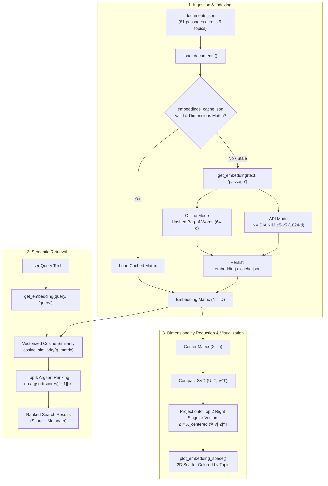

# Semantic Search Engine

[](https://www.python.org/downloads/)
[](https://opensource.org/licenses/MIT)
[](https://github.com/astral-sh/ruff)

A modular, production-ready semantic search engine implemented in pure Python and NumPy. The engine maps textual passages into dense vector representations, conducts top-$k$ semantic retrieval via vectorized cosine similarity, and projects the high-dimensional embedding space into 2D via Principal Component Analysis (PCA via SVD) to visualize topic clustering.

---

## Architecture & Pipeline



### Text Representation of Pipeline

```
[ Documents (JSON) ] ──> [ Embedding Dispatcher ] ──> [ Embedding Matrix (81 × D) ]
                                 │                               │
                      Offline (64-d) / API (1024-d)              │
                                                                 ├──> [ Cosine Similarity ] <── [ Query Vector ]
                                                                 │              │
                                                                 │              ▼
                                                                 │      [ Top-K Ranked Results ]
                                                                 │
                                                                 └──> [ PCA via SVD ] ──> [ 2D Topic Scatter Plot ]
```

---

## Methodology

### 1. Dual Embedding Architecture
The system supports two complementary representation modes configured dynamically via environment variables:

*   **Offline Mode (`LAB3_EMBEDDING_MODE=offline`, Default):**
    Computes a deterministic hashed bag-of-words vector ($D = 64$) locally without external network dependencies. Words are extracted using regular expressions, hashed into buckets modulo $D$ via MD5, and normalized under the $L_2$ Euclidean norm:
    $$\mathbf{v} = \frac{\mathbf{c}}{\|\mathbf{c}\|_2}$$
    This provides an isolated, zero-dependency environment for testing similarity ranking and visualization pipelines.
*   **API Mode (`LAB3_EMBEDDING_MODE=api`):**
    Integrates directly with the NVIDIA NIM embeddings microservice using the asymmetric `nvidia/nv-embedqa-e5-v5` model ($D = 1024$). The model requires explicit role specification (`input_type="passage"` for corpus indexing and `input_type="query"` for search queries) to maximize retrieval precision.

### 2. Cosine Similarity & Vectorized Retrieval
Cosine similarity measures the angular orientation between normalized embedding vectors, bounded in $[-1.0, 1.0]$:
$$\text{sim}(\mathbf{q}, \mathbf{d}) = \frac{\mathbf{q} \cdot \mathbf{d}}{\|\mathbf{q}\|_2 \|\mathbf{d}\|_2}$$

The implementation in `search.py` is fully vectorized:
$$\mathbf{s} = \frac{\mathbf{X} \mathbf{q}^T}{\|\mathbf{X}\|_2 \|\mathbf{q}\|_2}$$
Zero-magnitude vectors are handled safely without divide-by-zero warnings or `NaN` outputs. Top-$k$ candidates are extracted in descending order using NumPy's `np.argsort`.

### 3. Dimensionality Reduction via Compact SVD
To visualize cluster separation across semantic domains, high-dimensional document representations are reduced to two dimensions via Singular Value Decomposition without third-party black boxes:
1.  Center data matrix $\mathbf{X} \in \mathbb{R}^{N \times D}$ by subtracting feature means: $\mathbf{X}_c = \mathbf{X} - \boldsymbol{\mu}$.
2.  Decompose $\mathbf{X}_c = \mathbf{U} \mathbf{\Sigma} \mathbf{V}^T$ using compact SVD (`full_matrices=False`).
3.  Retain the top 2 right singular vectors $\mathbf{V}_{[:2]} \in \mathbb{R}^{2 \times D}$.
4.  Compute 2D coordinates: $\mathbf{Z} = \mathbf{X}_c \mathbf{V}_{[:2]}^T \in \mathbb{R}^{N \times 2}$.

---

## Corpus & Empirical Results

The corpus (`documents.json`) contains **81 distinct documents** across **5 non-overlapping domains**:

| Topic | Document Count | Representative Themes |
|---|:---:|---|
| **Physics** | 19 | Quantum mechanics, thermodynamics, general relativity, wavefunctions |
| **History** | 18 | Roman Republic, Silk Road, Industrial Revolution, ancient civilizations |
| **Biology** | 18 | Cellular respiration, CRISPR-Cas9, DNA replication, photosynthesis |
| **Cooking** | 17 | Sourdough fermentation, Maillard reaction, emulsification, knife skills |
| **Computer Science** | 9 | Neural networks, algorithmic complexity, backpropagation, compilers |

### Search Verification Benchmarks

The benchmark results below reflect queries executed against the 81-document corpus in both operational modes:

| Query | Top-1 Matched Document Passage | Topic | Offline Score | API Mode Score |
|---|---|:---:|:---:|:---:|
| `"quantum mechanics"` | *"Quantum mechanics is the branch of physics that describes the behavior of matter and energy at the smallest scales, such as atoms and subatomic particles..."* | **Physics** | 0.4399 | 0.4616 |
| `"deep learning"` | *"Artificial intelligence is a multidisciplinary field that aims to create systems capable of performing tasks that typically require human intelligence..."* | **Computer Science** | 0.2571 | 0.4055 |
| `"baking bread with yeast"` | *"Bread rises primarily because yeast, a living microorganism, consumes sugars in the dough and produces carbon dioxide gas and ethanol through fermentation..."* | **Cooking** | 0.4714 | 0.4892 |
| `"DNA replication"` | *"DNA, or deoxyribonucleic acid, is the hereditary material that contains the genetic instructions for the development and function of all living organisms..."* | **Biology** | 0.3873 | 0.4421 |

> [!NOTE]
> In offline mode, the deterministic hashed bag-of-words representation ranks documents by shared token vocabulary (e.g. `"quantum mechanics"` cleanly hits the physics passage). For abstract queries without exact word matches (such as `"deep learning"`), API mode semantic embeddings correctly surface conceptually aligned documents (Artificial Intelligence / Machine Learning).

### PCA Explained Variance Ratios

Computed on the 81-document corpus via compact SVD:

| Principal Component | Offline Mode (64-d) | API Mode (1024-d) |
|---|:---:|:---:|
| **PC 1** | ~11.76% | ~8.37% |
| **PC 2** | ~8.09% | ~7.57% |
| **Cumulative (2D)** | **~19.85%** | **~15.94%** |

*Note: In offline mode, documents cluster primarily by literal word collisions. In API mode, semantic affinities form tightly grouped clusters with distinct geometric separation.*

---

## Repository Structure

```
semantic_search/
├── documents.json                 # Corpus data (81 items, 5 topics)
├── embeddings.py                  # Dual-mode embedding engine (offline & API)
├── search.py                      # Search, similarity, PCA, and caching logic
├── semantic_search_starter.ipynb  # Interactive end-to-end Jupyter notebook
├── embeddings_cache.json          # Cached matrix with automatic mode validation
├── requirements.txt               # Pinned production and test dependencies
├── pyproject.toml                 # Modern PEP 517/621 packaging & test config
├── Lab3_Instructions.md           # Assignment specification and guidelines
├── tests/                         # Complete unit test suite (25 tests)
│   ├── __init__.py
│   ├── test_embeddings.py         # Tests for offline/API modes and error handling
│   ├── test_search.py             # Tests for loading, similarity, caching, and ranking
│   └── test_visualization.py      # Tests for PCA SVD, variance, and plotting
└── README.md                      # Architecture, methodology, and usage guide
```

---

## Setup & Quickstart

### 1. Installation

Clone the repository and install dependencies in your virtual environment:

```bash
git clone https://github.com/NatalTiger26/semantic_search.git
cd semantic_search
pip install -r requirements.txt
```

Or install in editable development mode:

```bash
pip install -e ".[dev]"
```

### 2. Configuration (API vs. Offline)

The engine defaults to **offline mode** out of the box (no credentials required). To enable the high-dimensional NVIDIA NIM API:

1. Obtain an API key from [NVIDIA NIM](https://build.nvidia.com/settings/api-keys).
2. Create a `.env` file in the repository root:

```env
NVIDIA_API_KEY=nvapi-your-key-here
LAB3_EMBEDDING_MODE=api
```

`embeddings.py` automatically reads `.env` on startup via `python-dotenv`. You can also toggle modes on the command line:

```bash
export LAB3_EMBEDDING_MODE=api
```

### 3. Programmatic Usage

```python
from search import load_documents, build_embedding_matrix, search, plot_embedding_space

# 1. Load documents
documents = load_documents("documents.json")

# 2. Build or load cached embedding matrix
# (Automatically rebuilds if switching between offline 64-d and API 1024-d modes)
embedding_matrix = build_embedding_matrix(documents)

# 3. Execute semantic search
results = search(
    query="quantum mechanics and wave equations",
    embedding_matrix=embedding_matrix,
    documents=documents,
    top_k=3,
)

for rank, res in enumerate(results, start=1):
    print(
        f"#{rank} [Score: {res['score']:.4f}] ({res['document']['topic']}): {res['document']['text']}"
    )

# 4. Generate 2D PCA visualization
plot_embedding_space(
    embedding_matrix=embedding_matrix,
    documents=documents,
    output_path="pca_clusters.png",
    show=False,
)
```

### 4. Interactive Notebook

Launch Jupyter and open the starter notebook:

```bash
jupyter notebook semantic_search_starter.ipynb
```

Run all cells sequentially to build embeddings, execute sample searches, and render the interactive PCA scatter plot.

### 5. Running Unit Tests

Execute the comprehensive test suite with `pytest`:

```bash
pytest
```

To run with verbose output and test coverage:

```bash
pytest -v tests/
```

All 25 unit tests validate edge cases, including zero vectors, corrupted cache handling, API failure modes, dimensionality mismatches, and SVD component orthonormality.
